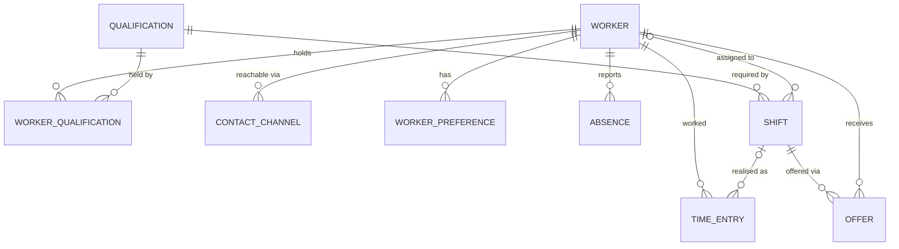

# ShiftFix: Domain & Database Schema

Backend data model for ShiftFix, on **SQLite**. See `context.md` for the problem statement.

## Conventions

- **The database enforces only `NOT NULL` and `UNIQUE`. Everything else is validated by the backend.** There are no `CHECK`s, triggers or `DEFAULT`s. All invariants are listed in [Invariants](#invariants).
- **The backend catches `sqlite3.IntegrityError`** from a `NOT NULL` or `UNIQUE` violation and maps it to a clear API error.
- **`REFERENCES` only documents relations.** `PRAGMA foreign_keys` stays off, so SQLite does not enforce them. The backend checks that referenced ids exist.
- **The backend sets every value, including `created_at` and `updated_at`.** It takes the time from its own clock, so the demo clock (07:00 scenario) works.
- **Timestamps** are `TEXT` in UTC with **minute precision**, always in the exact format `YYYY-MM-DDTHH:MMZ`, e.g. `2026-10-20T07:00Z`. Because the format never varies, comparing strings gives chronological order, so range and overlap queries work. Every write goes through `to_db(dt)`, which converts to UTC, truncates to the minute and formats. Every read goes through `from_db(s)`.
- **Local values** are taken in `Europe/Brussels`. Dates are `TEXT` `YYYY-MM-DD` and wall-clock times are `TEXT` `HH:MM`. Day and week boundaries for the labour rules are computed in this timezone, which handles DST. A week is the ISO week, Monday to Sunday.
- **Other types:**
  - Enums: `TEXT` (values below)
  - Booleans: `INTEGER` 0/1
  - Money: `INTEGER` cents
  - Hours: `REAL`
  - JSON: `TEXT`
- **Use `PRAGMA journal_mode = WAL`.** Writes that must be atomic use `BEGIN IMMEDIATE`; the main one is accepting an offer.
- **Derived values are never stored.** Hours worked, remaining quota and eligibility are always computed from rows.
- **Workers are deactivated** (`is_active = 0`), never deleted, so history and the audit trail stay intact.

## Enums

| enum | values |
|---|---|
| `contract_type` | `full_time`, `part_time`, `student` |
| `language` | `nl`, `fr`, `en` |
| `channel_type` | `telegram`, `sms`, `whatsapp`, `email`, `phone` |
| `shift_status` | `scheduled`, `open`, `cancelled` |
| `absence_type` | `sick`, `vacation`, `unavailable` |
| `offer_status` | `pending`, `accepted`, `declined`, `expired`, `cancelled` |
| `preference_kind` | `prefer`, `avoid` |

## ER diagram



## Tables

```sql
PRAGMA journal_mode = WAL;
```

### `worker`

An employee. `priority_factor` (0–3) is used **only to rank** replacement candidates and never filters anyone out. `student_hours_external_ytd` holds the hours a student already used this calendar year at **other** employers, because the Belgian student quota counts across all employers.

```sql
CREATE TABLE worker (
  id                         INTEGER PRIMARY KEY,
  first_name                 TEXT    NOT NULL,
  last_name                  TEXT    NOT NULL,
  hourly_rate_cents          INTEGER NOT NULL,   -- EUR gross per hour, in cents
  contract_type              TEXT    NOT NULL,   -- contract_type
  contract_hours_per_week    REAL    NOT NULL,
  priority_factor            INTEGER NOT NULL,   -- 0..3, ranking only
  language                   TEXT    NOT NULL,   -- language
  student_hours_external_ytd REAL    NOT NULL,   -- students only; 0 for everyone else
  is_active                  INTEGER NOT NULL,   -- 0/1
  created_at                 TEXT    NOT NULL    -- UTC
);
```

### `qualification`

Roles and qualifications are **one entity**. A shift requires exactly one, and a worker can hold many. To get "the workers with this role", join through `worker_qualification`. The list is stored only there, never on both sides.

```sql
CREATE TABLE qualification (
  id   INTEGER PRIMARY KEY,
  code TEXT NOT NULL UNIQUE,   -- e.g. 'cashier', 'bakery', 'forklift'
  name TEXT NOT NULL
);
```

### `worker_qualification` (many-to-many)

```sql
CREATE TABLE worker_qualification (
  worker_id        INTEGER NOT NULL REFERENCES worker(id),
  qualification_id INTEGER NOT NULL REFERENCES qualification(id),
  valid_until      TEXT,   -- 'YYYY-MM-DD' certificate expiry; NULL = never expires
  PRIMARY KEY (worker_id, qualification_id)
);
CREATE INDEX ix_wq_qualification ON worker_qualification(qualification_id);
```

### `contact_channel`

How to reach a worker. `address` holds the Telegram `chat_id`, an E.164 phone number or an email. Each worker has one row per channel type and at most one preferred channel.

```sql
CREATE TABLE contact_channel (
  id           INTEGER PRIMARY KEY,
  worker_id    INTEGER NOT NULL REFERENCES worker(id),
  type         TEXT    NOT NULL,   -- channel_type
  address      TEXT    NOT NULL,
  is_preferred INTEGER NOT NULL,   -- 0/1
  UNIQUE (worker_id, type)
);
CREATE UNIQUE INDEX ux_contact_preferred ON contact_channel(worker_id) WHERE is_preferred = 1;
```

### `worker_preference` (soft, ranking only)

Time windows a worker prefers or wants to avoid. These never filter anyone out. Windows can't cross midnight, so an overnight window is stored as two rows.

```sql
CREATE TABLE worker_preference (
  id         INTEGER PRIMARY KEY,
  worker_id  INTEGER NOT NULL REFERENCES worker(id),
  weekday    INTEGER,            -- ISO weekday 1..7; NULL = every day
  start_time TEXT    NOT NULL,   -- 'HH:MM' local
  end_time   TEXT    NOT NULL,   -- 'HH:MM' local
  kind       TEXT    NOT NULL    -- preference_kind
);
CREATE INDEX ix_pref_worker ON worker_preference(worker_id);
```

### `shift` (the plan)

A planned slot that requires one qualification. When the assignee reports sick, the shift becomes `open` and its `worker_id` becomes `NULL`.

```sql
CREATE TABLE shift (
  id               INTEGER PRIMARY KEY,
  qualification_id INTEGER NOT NULL REFERENCES qualification(id),
  worker_id        INTEGER REFERENCES worker(id),   -- NULL while open
  starts_at        TEXT    NOT NULL,                -- UTC
  ends_at          TEXT    NOT NULL,                -- UTC; may cross local midnight
  status           TEXT    NOT NULL,                -- shift_status
  created_at       TEXT    NOT NULL,
  updated_at       TEXT    NOT NULL
);
CREATE INDEX ix_shift_worker_start ON shift(worker_id, starts_at);
CREATE INDEX ix_shift_status_start ON shift(status, starts_at);
```

### `time_entry` (fact: actual worked time)

```sql
CREATE TABLE time_entry (
  id         INTEGER PRIMARY KEY,
  worker_id  INTEGER NOT NULL REFERENCES worker(id),
  shift_id   INTEGER REFERENCES shift(id),   -- the planned shift this entry fulfils, if any
  started_at TEXT    NOT NULL,               -- UTC
  ended_at   TEXT    NOT NULL                -- UTC
);
CREATE INDEX ix_time_entry_worker_start ON time_entry(worker_id, started_at);
CREATE INDEX ix_time_entry_shift        ON time_entry(shift_id);
```

### `absence`

**By design there is no reason, diagnosis or free-text column** (GDPR data minimisation). The raw sick message from the bot is parsed and then discarded.

```sql
CREATE TABLE absence (
  id         INTEGER PRIMARY KEY,
  worker_id  INTEGER NOT NULL REFERENCES worker(id),
  type       TEXT    NOT NULL,   -- absence_type
  starts_at  TEXT    NOT NULL,   -- UTC
  ends_at    TEXT    NOT NULL,   -- UTC
  created_at TEXT    NOT NULL
);
CREATE INDEX ix_absence_worker_start ON absence(worker_id, starts_at);
```

### `offer`

An offer of an open shift to a candidate. Two uniqueness rules protect it:
- `UNIQUE (shift_id, worker_id)`: the same person is never asked twice for the same shift.
- `ux_offer_one_accepted`: the database allows at most one accepted offer per shift.

```sql
CREATE TABLE offer (
  id           INTEGER PRIMARY KEY,
  shift_id     INTEGER NOT NULL REFERENCES shift(id),
  worker_id    INTEGER NOT NULL REFERENCES worker(id),
  wave         INTEGER NOT NULL,   -- batch number in the offer cascade, starting at 1
  status       TEXT    NOT NULL,   -- offer_status
  channel      TEXT,               -- channel_type the offer was sent through
  score        REAL,               -- ranking score when sent
  sent_at      TEXT    NOT NULL,
  expires_at   TEXT,
  responded_at TEXT,
  UNIQUE (shift_id, worker_id)
);
CREATE UNIQUE INDEX ux_offer_one_accepted ON offer(shift_id) WHERE status = 'accepted';
CREATE INDEX ix_offer_worker_status ON offer(worker_id, status);
```

### `audit_event` (append-only)

Records every action that matters. `shift_assigned` events carry the full rule-check results and the `rules.json` version in `payload`.

```sql
CREATE TABLE audit_event (
  id          INTEGER PRIMARY KEY,
  occurred_at TEXT    NOT NULL,
  actor       TEXT    NOT NULL,   -- 'system' | 'manager' | 'bot' | 'worker:<id>'
  action      TEXT    NOT NULL,   -- absence_reported, shift_opened, offer_sent, offer_declined,
                                  -- offer_accepted, shift_assigned, assignment_rejected
  shift_id    INTEGER REFERENCES shift(id),
  worker_id   INTEGER REFERENCES worker(id),
  payload     TEXT                -- JSON
);
CREATE INDEX ix_audit_shift ON audit_event(shift_id);
```

## Invariants

**Enforced by the database**
- `NOT NULL` on every required column.
- `qualification.code` is unique.
- `contact_channel`: one row per `(worker_id, type)`, and at most one `is_preferred = 1` per worker.
- `offer`: one row per `(shift_id, worker_id)`, and at most one `accepted` offer per shift.

**Enforced by the backend only**
- Enum columns hold only the values in [Enums](#enums).
- Value ranges:
  - `hourly_rate_cents ≥ 0`
  - `contract_hours_per_week > 0`
  - `priority_factor ∈ 0..3`
  - `weekday ∈ 1..7`
  - `wave ≥ 1`
  - `student_hours_external_ytd ≥ 0`
  - booleans `∈ {0,1}`
- `student_hours_external_ytd = 0` unless `contract_type = 'student'`.
- Every interval has end > start: shift, time_entry and absence. For `worker_preference`, `end_time > start_time`.
- Timestamps are written only through `to_db()`, which guarantees the format. `payload` is valid JSON.
- Referenced ids exist: worker, qualification and shift.
- A `scheduled` shift has a `worker_id`. An `open` shift has `worker_id = NULL`.
- A worker never has two overlapping `scheduled` shifts.
- `audit_event` is append-only. The repository exposes insert only, with no update or delete.

## Labour rules config (a file, not a table)

The rules live in `rules.json`, versioned in git. Its `version` is copied into every `shift_assigned` audit payload. The values are a **team-defined simplification**, to be confirmed before the demo.

```json
{
  "version": "2026-10-19.1",
  "timezone": "Europe/Brussels",
  "min_rest_hours": 11,
  "max_daily_hours": 9,
  "weekly_max_hours": { "full_time": 40, "student": 20 },
  "part_time_max_over_contract_hours": 4,
  "absolute_weekly_max_hours": 48,
  "student_yearly_quota_hours": 650
}
```

## Derived values (computed, never stored)

**Worked or planned hours in a window** for a worker, per interval:
- A `scheduled` shift that has a `time_entry` → use the time entry.
- A future `scheduled` shift with no `time_entry` → use the shift's planned interval.
- A `time_entry` with `shift_id IS NULL` (ad-hoc work) → use it as is.

Intervals are clipped to the window, and day and week boundaries are taken in `Europe/Brussels`. This avoids counting the same work twice.

**Student YTD hours** = `student_hours_external_ytd` + the hours above for the current calendar year.

**Rest gaps**: from the end of the previous interval to the candidate shift's start, and from the shift's end to the start of the next interval.

## Hard rules → data they read

| rule | reads |
|---|---|
| `qualification` | `worker_qualification` for the shift's qualification, with `valid_until` NULL or ≥ the shift's local date |
| `availability` | `absence` overlapping the shift |
| `no_overlap` | the worker's `scheduled` shifts overlapping the shift |
| `min_rest` | the worker's adjacent `shift` and `time_entry` intervals vs `min_rest_hours` |
| `max_daily` | hours on the local day + the shift vs `max_daily_hours` |
| `max_weekly` | hours in the ISO week + the shift vs the limit for the contract type (`contract_hours_per_week` + allowed extra for part-timers) |
| `student_quota` | `contract_type = 'student'`, student YTD hours + the shift vs `student_yearly_quota_hours` |

## Ranking inputs (soft, applied after the hard filter)

- `priority_factor`: higher ranks first.
- `hourly_rate_cents`: cheaper ranks first, plus the remaining contract hours this week.
- `worker_preference`: windows marked `prefer` and `avoid`.
- Fairness: the number of `accepted` offers in the last 30 days (fewer ranks first).
- Reachability: whether the worker has a preferred `contact_channel`.

## Lifecycle: "07:00 sick, shift at 09:00"

1. Insert an `absence` row. The worker's overlapping `scheduled` shifts become `open` with `worker_id = NULL`. An `absence_reported` event and a `shift_opened` event are written to the audit log; `shift_opened` keeps the original assignee in its payload.
2. Candidates are evaluated: hard rules filter, then the remaining candidates are ranked.
3. Insert the `offer` rows for wave 1 (`pending`) and write an `offer_sent` event.
4. When someone accepts, **one `BEGIN IMMEDIATE` transaction** does the following. Its write lock serialises concurrent accepts.
   1. Re-read the shift and the offer. The shift must still be `open` and the offer still `pending`; otherwise the answer is "already filled".
   2. Re-run all hard rules.
   3. Set the offer to `accepted`. `ux_offer_one_accepted` is a last safety net against a second winner. Set the shift's `worker_id` and status `scheduled`.
   4. Set the other `pending` offers to `cancelled`.
   5. Write `shift_assigned` with the rule snapshot.

   If the re-check fails, roll back and write `assignment_rejected` instead.
5. A decline sets the offer to `declined`. When every offer in a wave is declined or has expired, the next wave starts.

## Deliberately not modelled (prototype)

Manager accounts and auth, multiple sites or locations, breaks inside time entries, date of birth (rules for minors), and payroll export.
